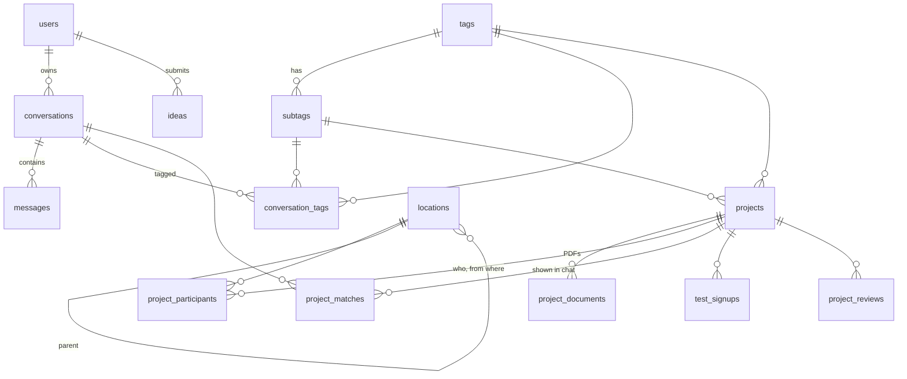

# Database schema

Status: implemented. The whole schema is created by the single Alembic revision `0001` (`backend/migrations/versions/`).
Every table below exists in PostgreSQL and in SQLite for quick local runs (`create_all`).
The squashed revision was verified against the previous migration chain: identical schema apart from column order.
Deviations from the original proposal are listed under each table. Endpoints: [API.md](API.md).

Scope: LLM conversations with tags/subtags, projects with PDFs, links and participation, ideas, pilot partners and their applications, and simple statistics for the admin. The vector database for RAG is an **external service**; this database stores only application data and the references the vector service returns.

## Conventions

- PostgreSQL + SQLAlchemy 2 async, one `CRUDRepo` per table.
- `id bigint` primary keys (`BigIntPK`: a bigserial sequence on PostgreSQL rather than `GENERATED AS IDENTITY`,
  INTEGER on SQLite), `created_at timestamptz default now()` on every table except `users`, `updated_at` where rows
  are edited in place (`projects`, `project_reviews`).
- Enums are `varchar` + `CHECK` (`native_enum=False`, like `users.role`).
- JSON columns are `JSON` on SQLite and `jsonb` on PostgreSQL. `UNIQUE ... NULLS NOT DISTINCT` exists on PostgreSQL;
  the repositories enforce the same rule for SQLite.
- **Person** for statistics: `user_id` when logged in, otherwise `visitor_id` (anonymous UUID cookie set by the backend). Unique people = `count(distinct coalesce('u' || user_id, 'v' || visitor_id))`.

## users

| Column | Type | Notes |
|---|---|---|
| id | bigint PK | |
| username | varchar unique | |
| hashed_password | varchar | argon2 |
| role | varchar | `admin`, `user`; `CHECK` |
| email | varchar unique null | stored lowercased |

## locations

Podkarpackie administrative units, linked to OpenStreetMap so the frontend can draw them directly on an OSM map.

| Column | Type | Notes |
|---|---|---|
| id | bigint PK | |
| teryt_code | varchar unique | official code (`teryt:terc` in OSM) |
| name | varchar | |
| kind | varchar | `voivodeship`, `county` (powiat), `municipality` (gmina) |
| parent_id | FK locations null | gmina → powiat → województwo |
| osm_relation_id | bigint null | OSM boundary relation, e.g. for links to openstreetmap.org/relation/{id} |
| latitude / longitude | double | centroid, for markers and `map.setView()` |
| boundary | jsonb null | simplified GeoJSON geometry (Polygon/MultiPolygon) |

Implemented with `created_at`, indexes on `kind` and `parent_id`. A location without a boundary is served as its
centroid `Point` in GeoJSON.

### OpenStreetMap integration

In OSM, Polish administrative boundaries are relations tagged `boundary=administrative` + `teryt:terc`:

| Kind | OSM `admin_level` |
|---|---|
| Voivodeship | 4 |
| County (powiat) | 6 |
| Municipality (gmina) | 7 |

**Import (implemented, `scripts/import_osm_locations.py`):**
1. One Overpass API request for `boundary=administrative` relations with `admin_level` 4, 6 and 7 and `teryt:terc`
   starting with `18`, inside the Podkarpackie area.
2. For each relation, take `teryt:terc`, `name` (verbatim, e.g. `powiat rzeszowski`, `gmina Solina`), the relation id,
   the centroid (or a representative point when the centroid falls outside), and the assembled geometry.
3. Simplify per level with `shapely.coverage_simplify` (neighbours keep shared borders), write
   `data/locations_podkarpackie.geojson` (~490 KB), and upsert by `teryt_code` with `scripts/seed_locations.py`;
   `parent_id` follows the TERYT prefix (7 → 4 → 2 digits).

Result (OSM data of 2026-11-21): 1 voivodeship, 25 powiats (incl. the 4 cities with powiat rights) and 160 gminas,
matching the official counts. The data is © OpenStreetMap contributors (ODbL).

The boundaries rarely change, so no runtime calls to OSM are needed.

**Frontend:**
1. Leaflet (`react-leaflet`) or MapLibre with OSM tiles.
2. The API returns standard GeoJSON `FeatureCollection`s (see API.md, `/locations/geojson` and `/projects/geojson`). They plug straight into `L.geoJSON(data)` / a MapLibre `geojson` source without conversion.
3. Statistics are included in feature `properties` for choropleth colouring.

Caveat: the public `tile.openstreetmap.org` server is fine for development and the demo, but its usage policy forbids heavy production traffic. For production, switch the tile URL to a commercial or self-hosted tile provider. The data and code stay the same.

## tags, subtags

Created and edited only by the admin. A subtag always belongs to exactly one tag.

`tags`

| Column | Type | Notes |
|---|---|---|
| id | bigint PK | |
| name | varchar unique | e.g. "Edukacja i szkoły" |
| description | text null | also given to the LLM as the label definition for classification |

`subtags`

| Column | Type | Notes |
|---|---|---|
| id | bigint PK | |
| tag_id | FK tags, `ON DELETE RESTRICT` | parent tag |
| name | varchar | e.g. "Szkolne projekty technologiczne"; `UNIQUE (tag_id, name)` |
| description | text null | |

Deleting a tag or subtag still used by subtags, projects or conversations returns 409 (`protect_on_delete`).

## conversations, messages

`conversations`

| Column | Type | Notes |
|---|---|---|
| id | bigint PK | |
| user_id | FK users null | null = anonymous |
| visitor_id | uuid null | anonymous owner (statistics only) |
| kind | varchar | `search` (matchmaking, default), `idea_assistant`, `middleman` |
| title | varchar null | AI-generated, editable |
| status | varchar | `active`, `archived` |
| outcome | varchar null | `answered`, `partially_answered`, `no_answer` |
| location_id | FK locations null | only when the user supplies it |
| last_activity_at | timestamptz | index `(user_id, last_activity_at desc)` |

Implemented with `created_at` (the statistics count conversations by it) and indexes on `visitor_id`, `location_id` and
`created_at`; `user_id` `ON DELETE CASCADE`, `location_id` `ON DELETE SET NULL`. There is no `expanded_query` column.

`messages` – stored only for logged-in users. Anonymous conversations keep no messages and no title; only the conversation row, tags, matches and outcome are kept for statistics.

| Column | Type | Notes |
|---|---|---|
| id | bigint PK | |
| conversation_id | FK conversations, cascade | index `(conversation_id, id)` |
| role | varchar | `user`, `assistant` |
| content | text | |
| sources | jsonb null | references returned by the external vector DB: `[{title, url, page, excerpt}]` |

### `conversation_tags`

The only join table. It is required because one conversation has many tags.

| Column | Type | Notes |
|---|---|---|
| conversation_id | FK conversations, cascade | |
| tag_id | FK tags | always set |
| subtag_id | FK subtags null | set when a more specific subtag applies; must belong to `tag_id` |

`UNIQUE (conversation_id, tag_id, subtag_id)` with `NULLS NOT DISTINCT`. The LLM assigns tags from the admin's list after each answer, and the user or admin can add or remove them.

Implemented with three extra columns: an `id` primary key (CRUDRepo convention), `created_at`, and `source`
(`ai` / `manual`, `CHECK`). Each answer replaces only the `ai` rows, so manual corrections survive.

Storing `tag_id` next to `subtag_id` keeps tag statistics a plain `GROUP BY tag_id` with no hierarchy walking.

## projects

A social innovation or project, recommended in the chat.

| Column | Type | Notes |
|---|---|---|
| id | bigint PK | |
| title | varchar | |
| summary | text | short card text |
| description | text | full description (markdown) |
| website_url | varchar null | project page |
| video_url | varchar null | |
| tag_id | FK tags | main category |
| subtag_id | FK subtags null | |
| location_id | FK locations null | where it is implemented |
| latitude / longitude | double null | map marker; defaults to the location centroid |
| status | varchar | `draft`, `published` (only published is visible and sent to the vector DB) |
| updated_at | timestamptz | |

Implemented with `created_at`; `status` `CHECK`; `tag_id`/`subtag_id` `ON DELETE RESTRICT`; indexes on `tag_id`,
`subtag_id`, `location_id`, `status`. The subtag must belong to the tag (checked by the API).

One tag + optional subtag per project keeps it simple. If projects later need several tags, add `project_tags` in the same shape as `conversation_tags`.

`project_documents` (PDFs):

| Column | Type | Notes |
|---|---|---|
| id | bigint PK | |
| project_id | FK projects, cascade | |
| title | varchar | accessible link text |
| file_path | varchar | storage key `projects/{project_id}/{uuid}.pdf` in the private S3 bucket, served via the API |
| size_bytes | bigint | |

Implemented with `created_at`. Deleting a project deletes its documents and the stored files.

On upload and publish, the backend sends the PDF to the external vector service. No chunks are stored here.

`project_participants` – how many people took part, and from where:

| Column | Type | Notes |
|---|---|---|
| id | bigint PK | |
| project_id | FK projects, cascade | |
| location_id | FK locations null | null = unknown |
| participants_count | int `CHECK >= 0` | |

`UNIQUE (project_id, location_id)` (`NULLS NOT DISTINCT` on PostgreSQL, so one "unknown" row per project). Total participants = `sum(participants_count)`. Counts for a powiat are summed from its gminas via `parent_id`. Implemented with `created_at`.

`project_matches` – a project shown to someone in the chat. This is the source for "how many people searched for this project".

| Column | Type | Notes |
|---|---|---|
| id | bigint PK | |
| project_id | FK projects | index `(project_id, created_at)` |
| conversation_id | FK conversations, cascade | |
| opened | bool default false | user opened the project card |

Implemented with `created_at` (the project statistics count by it) and `UNIQUE (conversation_id, project_id)`: one row
per project per conversation, so repeated recommendations do not inflate the counts. `project_id` is
`ON DELETE RESTRICT`: a project shown in the chat cannot be deleted (409); unpublish it instead.

## ideas (idea creator – fiszka)

| Column | Type | Notes |
|---|---|---|
| id | bigint PK | |
| author_id | FK users | |
| title | varchar | |
| essence | text | what the idea is about |
| target_group | text | who it is for |
| stage | varchar | `idea`, `prototype`, `micro_scale_test`, `implemented` |
| tag_id | FK tags null | |
| location_id | FK locations null | |
| status | varchar | `submitted`, `published`, `rejected` |

Implemented with `created_at`, `CHECK`s on `stage` and `status`, indexes on `author_id`, `tag_id`, `status`;
`author_id` `ON DELETE CASCADE`, `tag_id`/`location_id` `ON DELETE SET NULL`.

## Tester

`test_signups` – willingness to test a project:

| Column | Type | Notes |
|---|---|---|
| id | bigint PK | |
| project_id | FK projects | |
| user_id | FK users | `UNIQUE (project_id, user_id)` |
| location_id | FK locations null | |
| message | text null | |

`project_reviews` – rating, feedback and improvement suggestions:

| Column | Type | Notes |
|---|---|---|
| id | bigint PK | |
| project_id | FK projects | |
| user_id | FK users | `UNIQUE (project_id, user_id)` |
| rating | smallint `CHECK 1..5` | |
| comment | text null | feedback / proposed improvements |

Both tables are implemented with `created_at` (and `updated_at` on reviews, which are replaced in place), an index on
`user_id`, `project_id`/`user_id` `ON DELETE CASCADE` and `test_signups.location_id` `ON DELETE SET NULL`. The project
average (`rating_avg`) is computed, not stored.

## visits (site usage)

One row per page view sent by the frontend.

| Column | Type | Notes |
|---|---|---|
| id | bigint PK | |
| visitor_id | uuid | anonymous cookie |
| user_id | FK users null | |
| path | varchar(512) | without query string or fragment |
| created_at | timestamptz | index |

`user_id` `ON DELETE SET NULL`. No IP address is stored.

## Statistics (queries, no extra tables)

| Statistic | Source |
|---|---|
| Site users per day | `visits`: distinct person per `date(created_at)` |
| Conversations per day | `conversations` |
| People searching in a tag / subtag | `conversation_tags` ⨝ `conversations`: distinct person (and count of conversations) per `tag_id` / `subtag_id` |
| Simple trends | Same, distinct people in the requested period vs the previous period of the same length, per tag and subtag; optionally per `location_id` (incl. the units inside it) |
| Questions without an answer | `conversations.outcome = 'no_answer'` per tag |
| How many people searched for a project | `project_matches` ⨝ `conversations`: distinct person per `project_id`; `opened` for card clicks |
| Innovations shown in the live chat | `innovation_matches` ⨝ `conversations`: distinct owner per `innovation_id`; `opened` for source-dialog opens |
| Live chat turns and outcomes | `chat_operations` ⨝ `conversations` (`workspace`): status and `result.outcome` per day |
| Project participants and their origin | `project_participants` |
| Testers / rating | `test_signups`, `project_reviews` |

A conversation counts once per tag, no matter how many follow-up messages it has. Days are UTC calendar days, for
period bounds and per-day series alike (a portable `date(...)` / `CAST(... AT TIME ZONE 'UTC' AS DATE)` construct in
`app/repos/stats_repo.py`); SQLite and PostgreSQL return identical results on the demo seed. Tag statistics count
conversations by `conversations.created_at`, project statistics count `project_matches.created_at`;
`registered_users`, participants, sign-ups, reviews and `rating_avg` are all-time. Indexes on `created_at` and the FK columns are enough at this scale. Precomputed daily tables can be added later if these queries get slow.

## Implemented workspace extension

`conversations.workspace` is a non-null Boolean with server default false. Existing
rows retain the legacy contract; authenticated workspace rows use the existing
user ownership, archive status, timestamps and `messages` table.

`chat_operations` represents one user/assistant pair and its durable retry state:

| Column | Type / constraint |
| --- | --- |
| id | bigint PK |
| conversation_id | FK conversations, cascade |
| key | varchar(36), unique with conversation_id |
| user_message_id | FK messages, cascade; stable across retries |
| assistant_message_id | nullable FK messages, cascade |
| content | text |
| status | varchar(16), CHECK processing/completed/failed |
| attempt | varchar(36), internal attempt identity |
| result | nullable JSONB (JSON on SQLite), answer + shown innovations/evidence + outcome |
| created_at / started_at | timezone-aware timestamp; started_at marks the lease |

A partial unique index on conversation_id where status is processing prevents two
pending turns in one thread. A short owner-row write lock serializes admission
across that account's threads; retrieval runs outside that lock. Atomic attempt
checks prevent a stale worker from writing another assistant message after retry.
Failed sends retain their single user message. Archiving retains operations and
messages internally; no retention duration or purge is defined.

### `innovation_matches`

A knowledge-base innovation shown in a workspace thread; the workspace counterpart of
`project_matches`, which only covers SQL `projects`. Source of `GET /stats/innovations`.

| Column | Type / constraint |
| --- | --- |
| id | bigint PK |
| conversation_id | FK conversations, cascade; unique with innovation_id |
| innovation_id | varchar(120), knowledge-base id (not an FK; innovations live in Qdrant) |
| title | text, title when first shown |
| opened | boolean, default false; set when the owner opens the source dialog |
| created_at | timestamptz; index with innovation_id |

Completed workspace turns also set `conversations.outcome` (`answered` / `no_answer`) from the
latest result, so the tag `no_answer` statistic covers the live chat.

### Demo data

`scripts/seed_demo.py` fills topics, demo accounts, ideas, pilot partner profiles and a deterministic
synthetic activity history from `data/demo/demo.json`, so the admin Analityka view has data.
Project texts in that file are real Interreg records; everything else is invented.

## Fastino topic classification extension

The schema has nullable `conversations.classification` (PostgreSQL JSONB / SQLite JSON)
for content-free classifier evidence. Label assignments retain the existing
`conversation_tags` table and `ai`/`manual` provenance. Knowledge documents persist
independent tag assignments and classification evidence in their Qdrant card metadata;
chunks copy tag/subtag IDs for retrieval. Innovation sectors (`Category`) remain independent.
Aggregate distinct conversations/documents per tag; do not count tag-pair rows or chunks as
separate needs. See [Fastino contract](../docs/FASTINO.md#topic-tagging).

The schema has nullable `conversations.tagged_at`: the `last_activity_at` value the stored topic tags cover.
A workspace conversation is due for tagging while `tagged_at` is null or older than `last_activity_at`.

## Pilot partner pool (internally: volunteer/tester pool)

The schema has `volunteer_profiles`, keyed by `user_id` (one per account,
cascading on account deletion), with required contact email/phone/description,
content-free classifier evidence (JSONB on PostgreSQL, JSON on SQLite), contact
acknowledgement timestamp and creation/update timestamps. Profiles do not reference
projects. Contact email is independent of account email.

`volunteer_tags` has composite key `(user_id, tag_id)` and an index on `tag_id`.
Both foreign keys cascade on deletion; deleting a profile removes its assignments.
The tags use the existing top-level taxonomy. Withdrawal deletes the entire profile,
including classifier evidence and acknowledgement, without deleting the account.
Existing project-specific `test_signups` and `project_reviews` are unchanged.

The schema has explicit, self-selected tester tags to `volunteer_profiles`:
`roles` and `interests` (JSONB on PostgreSQL, JSON on SQLite, `NOT NULL`, default `[]`).
`roles` holds `TesterRole` partner-type slugs ("Kim jesteś", `app/modules/tester_tags.py`);
`interests` holds innovation sector `Category` slugs ("W jakich sektorach możesz pilotować?"), so
partner interests match innovation sectors directly. The automatic `volunteer_tags` stay; `description` may now be empty, and then
no automatic tagging runs.

The schema has `tester_applications`: `id`, `user_id` (FK
`volunteer_profiles.user_id`, cascade, indexed), `innovation_id` (knowledge innovation
slug, `String(120)`, indexed, no FK because innovations live in Qdrant), `status`
(`pending|approved|rejected`), `source` (`tester|admin`), optional `message`,
`decided_by` (FK `users.id`, `SET NULL`), `decided_at`, `created_at`, `updated_at`, and a
unique `(user_id, innovation_id)`. Withdrawing a tester profile deletes its applications;
deleting an innovation leaves orphan rows that show the slug.

## Progressive chat case card

The existing `chat_guides` JSON `data` now contains `facts`, `notes` and optional
`case_started_at`. `facts` stores exact user quotations about the reported innovation
(role, institution, location, idea, problem, users, solution, novelty, development stage,
evidence, creators, IP status, needs, scale, partners and goals; `app/chat/guide.py`),
plus a short supported source context. `notes` keeps advisory AI
feedback, proposed next steps and open questions separately from user facts. Missing
fields are optional. Historical confirmation/skip/presented flags no longer control
available agent capabilities. Resetting an unrelated case clears its facts/notes and
sets a UTC time boundary used by the staff-contact summary.

## matters ("Moje sprawy")

User-owned Markdown documents ("sprawy"), edited by hand under "Moje sprawy" and by the workspace agent.
Unlike `chat_artifacts`, which belong to one agent conversation, a matter belongs to a user.

| Column | Type | Notes |
| --- | --- | --- |
| `id` | bigint PK | |
| `user_id` | FK `users.id`, `ON DELETE CASCADE`, indexed | owner |
| `title` | `varchar(200)` | |
| `type` | `varchar(32)` + CHECK | `idea_card`, `application_draft`, `adaptation_plan`, `note` |
| `status` | `varchar(16)` + CHECK | `draft` (default), `ready`, `sent` |
| `content_markdown` | text | at most 20000 characters (validated in the schema and agent tools) |
| `revision` | integer | starts at 1; every write is `UPDATE ... WHERE id = ? AND revision = ?` and increments it |
| `conversation_id` | FK `conversations.id`, `ON DELETE SET NULL`, nullable | linked workspace thread |
| `created_at`, `updated_at` | timestamptz | `updated_at` is set on every content write |

Index `(user_id, updated_at)` serves the newest-first list. Linking a thread does not change the revision.
Existing workspace `chat_artifacts` are not migrated.

## contact_messages (contact form, Alembic)

Messages sent through the public contact form (`POST /contact`).
A message is stored before any mail delivery, so it is never lost when SMTP is missing or fails.

| Column | Type | Notes |
| --- | --- | --- |
| `id` | bigint PK | |
| `name` | `varchar(120)` | single line, 2-120 characters (validated in the schema) |
| `email` | `varchar(254)` | validated, lowercased |
| `message` | text | 10-5000 characters (validated in the schema) |
| `user_id` | FK `users.id`, `ON DELETE SET NULL`, nullable | sender's account when logged in |
| `delivered` | boolean | set when the message was also e-mailed to `RADAR_CONTACT_EMAIL` |
| `created_at` | timestamptz | indexed, serves the newest-first admin list |

The required consent is checked at submission and implied by the row; it is not stored separately.
No IP address is stored.
